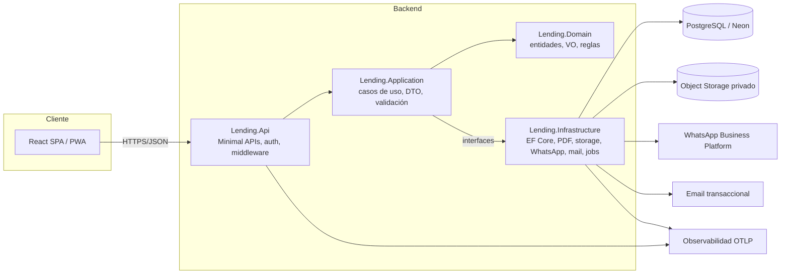
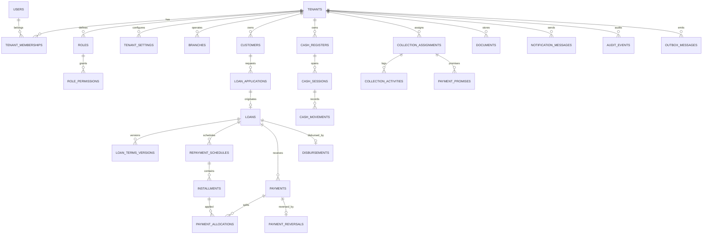

# 02 — Arquitectura, dominio, datos, API y frontend

## 1. Estilo arquitectónico

**Monolito modular con Clean Architecture.** Un solo despliegue de API y un solo frontend,
con módulos de negocio separados internamente. No se introducen microservicios: no hay
evidencia de necesidad de escalado independiente ni de equipos autónomos, y sí un fuerte
requisito de consistencia transaccional en pagos y caja.



Regla de dependencias: `Api → Application → Domain`; `Infrastructure → Application/Domain`.
`Domain` no referencia ASP.NET Core, EF Core, React ni SDKs externos.

### 1.1 Proyectos

```
backend/
  src/
    Lending.Api/               # endpoints, auth, middleware, DI, OpenAPI
    Lending.Application/       # casos de uso por módulo, DTOs, validadores, puertos
    Lending.Domain/            # agregados, value objects, enums, reglas, eventos
    Lending.Infrastructure/    # EF Core, migraciones, adaptadores externos, jobs
  tests/
    Lending.UnitTests/
    Lending.IntegrationTests/
    Lending.ArchitectureTests/
    Lending.IsolationTests/    # puede vivir dentro de Integration; se separa para CI
frontend/
  src/{app,components,features,hooks,lib,routes,services,types,utils}
tests/e2e/                     # Playwright
docs/
infra/                         # docker, pipelines, IaC si aplica
```

Módulos de aplicación previstos: `Identity`, `Tenancy`, `Customers`, `LoanApplications`,
`Loans`, `Schedules`, `Payments`, `Cash`, `Collections`, `Reporting`, `Documents`,
`Notifications`, `Platform`, `Audit`.

Cada módulo expone casos de uso explícitos (clases `...Handler` o servicios de aplicación)
y su propio conjunto de DTOs. No se crea un bus de mediación solo por convención; si se
adopta MediatR se justificará en un ADR por reducción real de acoplamiento en endpoints.

### 1.2 Stack objetivo y verificación de versiones

| Componente | Objetivo | Estado en el entorno | Acción en Fase 1 |
|---|---|---|---|
| .NET / ASP.NET Core | .NET 10 (LTS) | SDK 10.0.100 instalado | Fijar `global.json` y versiones de paquetes |
| EF Core + Npgsql | EF Core 10 + Npgsql 10 | — | Verificar compatibilidad y fijar versión exacta |
| PostgreSQL | 17+ (según disponibilidad en Neon) | — | Crear proyecto Neon y registrar versión |
| React + TypeScript | React 19, TS estricto | Node 20.19.5 / npm 10.8.2 | Fijar versiones estables vigentes |
| Vite | última estable | — | Fijar versión |
| TanStack Query / Router | v5 / v7 (o estable vigente) | — | Fijar versión |
| UI | shadcn/ui + Radix + Tailwind | — | Confirmar en Fase 1 |
| Tablas / Gráficos | TanStack Table / Recharts | — | Confirmar en Fase 1 |
| Pruebas | xUnit, Vitest, RTL, Playwright | — | Configurar en Fase 1 |
| Logging | Serilog + OpenTelemetry | — | Configurar en Fase 1 |

Nota: las versiones exactas se fijan al iniciar la Fase 1, verificando soporte vigente.
No se declara ninguna versión como “elegida” sin haberla instalado y compilado.

### 1.3 Decisiones arquitectónicas iniciales (ADR resumidos)

| ID | Decisión | Motivo | Alternativa descartada |
|---|---|---|---|
| ADR-001 | Monolito modular | Consistencia transaccional y menor coste operativo | Microservicios |
| ADR-002 | Clean Architecture por proyectos | Pruebas de dominio aisladas y dirección de dependencias verificable | Capas informales |
| ADR-003 | Esquema compartido + `tenant_id` + RLS | Coste y operación simples para muchos tenants pequeños | Base/esquema por tenant |
| ADR-004 | EF Core + SQL explícito cuando aporte | Productividad y control de consultas críticas | Dapper puro |
| ADR-005 | Minimal APIs agrupadas por módulo | Menos ceremonia, validación por filtros, OpenAPI | MVC Controllers |
| ADR-006 | Outbox transaccional | Evita perder eventos entre BD y proveedores externos | Envío directo en request |
| ADR-007 | JWT corto + refresh opaco rotativo | Revocación real y menor exposición de tokens | JWT largo / sesión en cookie |
| ADR-008 | Eventos de dominio internos + auditoría persistida | Trazabilidad sin acoplar módulos | Llamadas directas cruzadas |
| ADR-009 | Jobs in-process con tabla de trabajos al inicio | Simplicidad; migrable a worker dedicado | Cola externa desde el día 1 |
| ADR-010 | Importes `numeric(18,2)`, tasas `numeric(12,8)` | Precisión y reconciliación | `float`/`double` |

## 2. Modelo de dominio

### 2.1 Agregados y responsabilidades

| Agregado | Raíz | Entidades / VO | Invariantes principales |
|---|---|---|---|
| Tenancy | `Tenant` | `TenantSettings`, `Branch`, `Subscription`, `Plan` | Tenant activo para operar; límites del plan respetados |
| Identity | `User` | `TenantMembership`, `Role`, `Permission`, `RefreshToken`, `Invitation` | Membresía activa y tenant activo para acceder |
| Customers | `Customer` | `CustomerContact`, `CustomerDocument`, `KycStatus` | Documento único por tenant; datos mínimos |
| Applications | `LoanApplication` | `ApplicationEvaluation`, `ApplicationAttachment` | Transiciones válidas; aprobación ≠ desembolso |
| Loans | `Loan` | `LoanTermsVersion`, `RepaymentSchedule`, `Installment` | Condiciones inmutables por versión; Σ cuotas reconciliada |
| Payments | `Payment` | `PaymentAllocation`, `PaymentReversal` | Pago confirmado no se borra; no sobrepago sin regla |
| Cash | `CashSession` | `CashMovement`, `Disbursement` | Sesión abierta para operar; movimientos inmutables |
| Collections | `CollectionAssignment` | `CollectionActivity`, `PaymentPromise` | Promesa ≠ pago; alcance por cartera |
| Documents | `Document` | `DocumentVersion` | Acceso por tenant; hash y metadatos |
| Notifications | `NotificationMessage` | `NotificationAttempt` | Estado real del proveedor; consentimiento |
| Audit | `AuditEvent` | — | Append-only |
| Platform | `IdempotencyRecord`, `OutboxMessage`, `BackgroundJob` | — | Unicidad por clave; reintentos acotados |

### 2.2 Value objects

- `Money` (`decimal Amount`, `Currency Currency`): operaciones solo entre misma moneda.
- `Percentage`/`InterestRate`: valor + `RatePeriod` + `RateType` (nominal/efectiva).
- `TenantId`, `CustomerId`, `LoanId`…: identificadores tipados.
- `DateRange`, `DueDate`, `BusinessDate`.
- `DocumentNumber` (tipo + número + país), `PhoneNumber` (E.164).
- `InstallmentNumber`, `OperationNumber`.
- `IdempotencyKey`.

### 2.3 Máquinas de estado

**LoanApplication**

```
Draft → PendingEvaluation → UnderReview → Approved → Disbursed
  ↘ Cancelled        ↘ Rejected        ↘ Cancelled
```
`Approved → Disbursed` solo mediante la creación/desembolso del préstamo y con permiso
distinto al de aprobación.

**Loan (ciclo de vida)** — eje separado de morosidad

```
Draft → PendingApproval → Approved → Disbursed → Active → Paid
                                   ↘ Voided        ↘ SettledEarly
                                   (solo con procedimiento auditado)
```

**DelinquencyStatus (derivado, no persistido como ciclo de vida)**
`Current | DueSoon | Overdue | DefaultCandidate`, calculado por cuotas vencidas y días de
atraso. Se puede persistir como campo materializado para reportes, pero nunca sustituye
el estado del préstamo.

**Installment**

```
Pending → PartiallyPaid → Paid
Pending/PartiallyPaid → Overdue (derivado por fecha y saldo)
Pending → Reprogrammed (cuando se reemplaza por nueva versión)
* → Voided (solo por procedimiento autorizado)
```

**Payment**: `Pending → Confirmed → Reversed` (nunca `Deleted`).
**CashSession**: `Open → Closed → Reconciled | ClosedWithDifference`.
**Document**: `Requested → Generated → Stored | Failed`.
**NotificationMessage**: `Queued → Submitted → Accepted → Sent → Delivered → Read`
con ramas `Failed → Retrying → DeadLettered`.

### 2.4 Eventos de dominio relevantes

`LoanDisbursed`, `ScheduleGenerated`, `PaymentConfirmed`, `PaymentReversed`,
`InstallmentOverdue`, `CashSessionClosed`, `DocumentGenerated`, `NotificationRequested`,
`MembershipChanged`, `TenantSuspended`. Se persisten en outbox cuando disparan efectos
externos.

## 3. Modelo de datos inicial

### 3.1 Diagrama entidad-relación (resumen)



### 3.2 Tablas y restricciones clave

Convención: toda tabla de negocio incluye `id uuid`, `tenant_id uuid NOT NULL`,
`created_at timestamptz`, `created_by uuid`, `updated_at timestamptz`, `updated_by uuid`,
`xmin` para concurrencia optimista (mapeo EF Core). Nombres en `snake_case`.

| Tabla | Campos críticos | Restricciones / índice |
|---|---|---|
| `tenants` | `slug`, `name`, `status`, `plan_id` | UNIQUE `slug`; CHECK status |
| `users` | `email`, `password_hash`, `status`, `email_verified_at` | UNIQUE `lower(email)` |
| `tenant_memberships` | `tenant_id`, `user_id`, `status` | UNIQUE `(tenant_id, user_id)`; FK compuesta |
| `roles` | `tenant_id`, `code`, `is_system` | UNIQUE `(tenant_id, code)` |
| `permissions` | `code` global | UNIQUE `code` |
| `role_permissions` | `role_id`, `permission_id` | PK compuesta |
| `customers` | `code`, `document_type`, `document_number`, `full_name`, `phone`, `status` | UNIQUE `(tenant_id, code)`, UNIQUE `(tenant_id, document_type, document_number)`; índice `(tenant_id, full_name)` |
| `loan_applications` | `customer_id`, `status`, `requested_amount`, `currency` | FK `(tenant_id, customer_id)`; índice `(tenant_id, status)` |
| `loans` | `code`, `customer_id`, `application_id`, `principal`, `currency`, `status`, `delinquency_status` | UNIQUE `(tenant_id, code)`; FK compuestas; índice `(tenant_id, status, delinquency_status)` |
| `loan_terms_versions` | `loan_id`, `version`, `rate`, `rate_period`, `rate_type`, `interest_method`, `frequency`, `term`, `first_due_date`, `rounding_policy` | UNIQUE `(tenant_id, loan_id, version)`; CHECK rate ≥ 0 |
| `repayment_schedules` | `loan_id`, `terms_version_id`, `version`, `status` | UNIQUE `(tenant_id, loan_id, terms_version_id)`; un solo `Active` por préstamo (índice parcial) |
| `installments` | `schedule_id`, `loan_id`, `number`, `due_date`, `principal_due`, `interest_due`, `other_due`, `total_due`, `principal_paid`, `interest_paid`, `other_paid`, `status` | UNIQUE `(tenant_id, schedule_id, number)`; CHECK importes ≥ 0; índice `(tenant_id, loan_id, due_date)` |
| `payments` | `operation_number`, `loan_id`, `customer_id`, `payment_date`, `amount`, `currency`, `method`, `status`, `idempotency_key` | UNIQUE `(tenant_id, operation_number)`, UNIQUE `(tenant_id, idempotency_key)`; CHECK amount > 0 |
| `payment_allocations` | `payment_id`, `installment_id`, `concept`, `amount` | CHECK amount > 0; UNIQUE `(payment_id, installment_id, concept)` |
| `payment_reversals` | `payment_id`, `reason`, `reversed_by`, `reversal_payment_id` | UNIQUE `payment_id` (un reverso por pago) |
| `cash_registers` / `cash_sessions` | `branch_id`, `status`, opening/closing amounts | Índice parcial: una sesión `Open` por caja |
| `cash_movements` | `session_id`, `type`, `amount`, `source_type`, `source_id` | CHECK amount > 0; inmutable |
| `collection_assignments` | `collector_id`, `customer_id`, `loan_id`, `assigned_from`, `assigned_to` | Índice `(tenant_id, collector_id, assigned_to)` |
| `documents` | `entity_type`, `entity_id`, `storage_key`, `sha256`, `mime_type`, `size_bytes` | UNIQUE `(tenant_id, storage_key)`; CHECK size > 0 |
| `notification_messages` | `channel`, `template`, `status`, `provider_message_id`, `consent_id` | Índice `(tenant_id, status, created_at)` |
| `idempotency_records` | `key`, `endpoint`, `request_hash`, `response_status`, `response_body`, `expires_at` | UNIQUE `(tenant_id, endpoint, key)` |
| `outbox_messages` | `type`, `payload`, `status`, `attempts`, `next_attempt_at` | Índice `(status, next_attempt_at)` |
| `audit_events` | `actor_id`, `action`, `entity_type`, `entity_id`, `before`, `after`, `correlation_id`, `ip_hash` | Índice `(tenant_id, occurred_at)`; append-only |
| `tenant_settings` | `timezone`, `currency`, `locale`, `business_day_rule`, `rate_cap_config` | UNIQUE `(tenant_id)` |

### 3.3 Prevención de referencias cruzadas entre tenants

No basta con `tenant_id` en cada tabla. Se usan **claves compuestas**:

```sql
ALTER TABLE customers
  ADD CONSTRAINT uq_customers_tenant_id_id UNIQUE (tenant_id, id);

ALTER TABLE loans
  ADD CONSTRAINT fk_loans_customer
  FOREIGN KEY (tenant_id, customer_id)
  REFERENCES customers (tenant_id, id);
```

Se replica el patrón en `installments → loans`, `payments → loans/customers`,
`payment_allocations → payments/installments`, `documents`, `collection_*`, etc.
Así, una fila del tenant A **no puede** referenciar una fila del tenant B ni por error de
aplicación.

### 3.4 Índices y rendimiento

- `installments (tenant_id, due_date, status)` y parcial `WHERE status IN ('Pending','Overdue')`.
- `payments (tenant_id, payment_date)` y `(tenant_id, loan_id)`.
- `loans (tenant_id, customer_id)`, `(tenant_id, status)`, `(tenant_id, code)`.
- `customers (tenant_id, document_number)`, `(tenant_id, phone)`.
- `audit_events (tenant_id, occurred_at DESC)`.
- Búsqueda de texto: `pg_trgm` sobre nombre si se requiere; evaluar antes de añadir.
- Paginación por keyset en listados grandes; `OFFSET` solo en páginas pequeñas.

### 3.5 Concurrencia y transacciones

- Pagos: `SELECT ... FOR UPDATE` sobre `loans` (o `pg_advisory_xact_lock` por `loan_id`)
  antes de leer cuotas y aplicar.
- `xmin` como token de concurrencia en EF Core para detectar ediciones simultáneas.
- Toda operación que afecte pago + cuotas + caja + outbox ocurre en **una transacción**.
- Reintentos acotados solo para errores transitorios (deadlock/serialización), nunca
  para errores de validación.

### 3.6 Auditoría, retención y borrado

- `audit_events` append-only; sin UPDATE/DELETE para el rol de aplicación.
- Datos financieros: sin borrado físico. “Eliminar” un cliente con historial no se permite;
  se inactiva.
- Borrado/anonimización solo por procedimiento legal aprobado y auditado.
- Retención mínima: **pendiente de validación legal** (ver `03-multitenancy-seguridad.md`).

## 4. Contratos de API

- Prefijo versionado: `/api/v1/...`.
- DTOs explícitos; nunca se exponen entidades EF.
- El cliente **no** puede enviar `tenant_id`, estados internos, importes confirmados ni
  campos de auditoría; si los envía, se ignoran o se rechaza la solicitud.
- Errores uniformes con **Problem Details** (`application/problem+json`) + `code` estable.
- Paginación `?page=&pageSize=&sort=&order=`; límites máximos de `pageSize`.
- Filtros permitidos por lista blanca; nunca SQL dinámico sin parametrizar.
- Idempotencia: cabecera `Idempotency-Key` en cobros, desembolsos, reversos y envíos.
- `ETag`/versión optimista en actualizaciones sensibles cuando aplique.
- OpenAPI generado y publicado; ejemplos sin datos reales.
- Rate limiting por IP y por usuario/tenant en auth y operaciones sensibles.

Endpoints previstos (se detallan en Fase 1):

```
/api/v1/auth/{login,refresh,logout,forgot-password,reset-password,tenant-context}
/api/v1/tenants, /memberships, /roles, /permissions
/api/v1/customers, /customers/{id}/loans, /customers/{id}/payments
/api/v1/loan-applications
/api/v1/loans, /loans/{id}/schedule, /loans/{id}/simulate
/api/v1/loans/{id}/disburse
/api/v1/payments, /payments/{id}/reverse
/api/v1/installments
/api/v1/collections/{assignments,activities,promises}
/api/v1/cash-registers, /cash-sessions
/api/v1/reports/{...}, /exports
/api/v1/documents, /documents/{id}/download
/api/v1/notifications
/api/v1/audit-events
```

## 5. Frontend

- React + TypeScript estricto + Vite; SPA con code splitting por módulo.
- TanStack Query para estado de servidor; claves de caché incluyen tenant y filtros.
- React Router con guards por permiso; ocultar UI **no** es control de seguridad.
- React Hook Form + Zod para validación de interfaz; el backend revalida todo.
- shadcn/ui + Radix + Tailwind para componentes accesibles y consistentes.
- TanStack Table para tablas con paginación de servidor, filtros y ordenamiento.
- Recharts para gráficos; formato `Intl.NumberFormat('es-PE')` y fechas `es-PE`.
- Estructura por features; sin lógica financiera de autoridad en React.
- Simulación de cronograma: llama al backend; no replica fórmulas.
- Manejo de sesión: access token en memoria; refresh en cookie `HttpOnly` `Secure`
  `SameSite=Strict` (o `Lax` si el flujo lo exige) con protección CSRF cuando aplique.
  **Decisión pendiente de confirmar en Fase 1** entre cookie httpOnly y almacenamiento
  en memoria con refresh opaco; se documentará en ADR con análisis de CSRF/XSS.
- Accesibilidad: foco visible, navegación por teclado, `aria-*`, contraste AA.
- PWA: instalable y con shell offline para consulta de cartera; **sin** registro offline
  de pagos en v1 (evita conflictos financieros).

## 6. Observabilidad y operación

- Serilog JSON + correlación (`trace_id`, `tenant_id` seudonimizado, `user_id`).
- OpenTelemetry: trazas API→EF Core→jobs; métricas de latencia, errores y negocio
  (pagos confirmados, outbox pendiente, documentos fallidos).
- Health checks: `/health/live`, `/health/ready` (BD y dependencias críticas).
- Alertas: 5xx sostenido, outbox atascado, fallos de migración, errores de webhook.
- Logs sin contraseñas, tokens, números de documento completos ni importes innecesarios.
- Retención de logs según proveedor y política de privacidad (pendiente).
